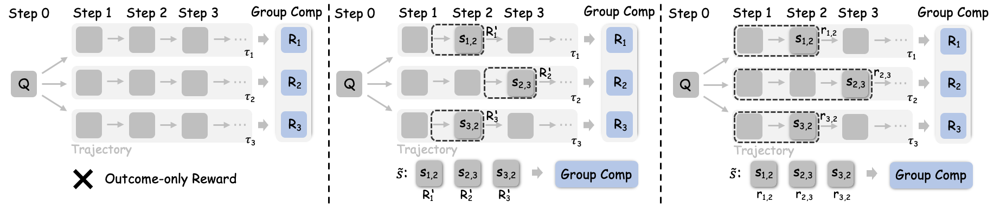
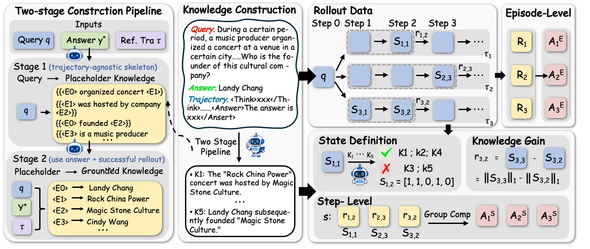
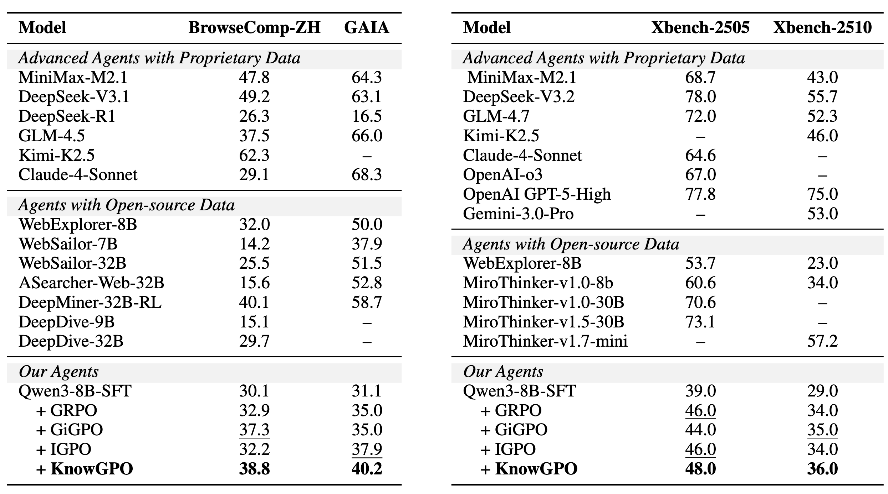

<h1 align="center">
  KnowGPO: Knowledge-Grouped Policy Optimization for Search Agents
</h1>

<p align="center">
  <a href="https://arxiv.org/abs/2610.22331"></a>
  <a href="LICENSE"></a>
</p>

<p align="center">
  Siqi Chen<sup>1,2</sup>, Zhengxi Lu<sup>1</sup>, Yuchen Yan<sup>1</sup>, Xingyu Wu<sup>1,2</sup>,
  Qipeng Chen<sup>1</sup>, Xin Zhang<sup>2</sup>, Aiting Liu<sup>2</sup><br>
  Chao Deng<sup>2</sup>, Jie Liu<sup>2</sup>, Jin Ma<sup>2</sup>, Weiming Lu<sup>1</sup>, Jun Xiao<sup>1</sup>, Yongliang Shen<sup>1&dagger;</sup>
</p>

<p align="center">
  <sup>1</sup> Zhejiang University &nbsp;&nbsp;&middot;&nbsp;&nbsp;
  <sup>2</sup> Tencent &nbsp;&nbsp;&middot;&nbsp;&nbsp;
  <sup>&dagger;</sup> Corresponding author
</p>

## 🔥 Overview

**KnowGPO** (Knowledge-Grouped Policy Optimization) is a reinforcement-learning method for long-horizon deep-search agents. Instead of matching surface observations across search trajectories, it groups steps by the task-relevant knowledge acquired so far and assigns process credit for newly verified knowledge conditions.

<p align="center">
  
</p>

## 🎉 News

- **November 01, 2026:** [KnowGPO: Knowledge-Grouped Policy Optimization for Search Agents](https://aclanthology.org/2026.emnlp-main.2357/) has been accepted to EMNLP 2026.
- **October 15, 2026:** [KnowGPO: Knowledge-Grouped Policy Optimization for Search Agents](https://arxiv.org/abs/2610.22331) is available on arXiv.

## 🌟 Highlights

- **Knowledge-state abstraction instead of surface observation matching.** KnowGPO groups trajectories by verified task-relevant knowledge conditions, achieving 97.8% effective step alignment vs. 51.8% for observation-based grouping.
- **Environment-grounded process rewards.** Incremental knowledge gain provides dense step-level supervision without learned critics, observation matching, or reliance on model confidence.
- **Strong deep search performance.** KnowGPO reaches 48.0% on Xbench-2505, 38.8% on BrowseComp-ZH, and 40.2% on GAIA with Qwen3-8B, matching or surpassing 32B open-source systems.

## 🤖 Method

<p align="center">
  
</p>

KnowGPO operates through three key components:

1. **Knowledge Condition Construction.** A two-stage pipeline decomposes each query into atomic knowledge conditions: Stage 1 extracts the reasoning skeleton with entity placeholders; Stage 2 grounds placeholders using the reference answer and a successful trajectory.

2. **Knowledge State Representation.** At each step t, an LLM verifier checks which conditions are satisfied by the cumulative history. The knowledge state s_{i,t} is a binary vector indicating acquired conditions, updated monotonically to absorb transient noise.

3. **Knowledge-Grouped Credit Assignment.** Steps sharing the same prior knowledge state are grouped. Episode-level advantages capture final outcomes; step-level advantages are computed by normalizing incremental knowledge gain (||s_{i,t}||₁ - ||s_{i,t-1}||₁) within each group. The two are combined with mixing coefficient ω.


## 📊 Performance

<p align="center">
  
</p>

KnowGPO consistently outperforms outcome-only and process-supervision baselines across three challenging deep search benchmarks. On BrowseComp-ZH, it achieves 38.8% (+5.9% over GRPO), matching the 32B DeepMiner-RL agent. On GAIA, it reaches 40.2% (+5.2% over GRPO), surpassing all tested process-supervision methods. On Xbench-2505, it improves to 48.0%, outperforming GRPO, GiGPO, and IGPO while using an 8B backbone.


## 🔖 Repository Layout

```text
KnowGPO/
├── assets/                             # Paper graphics and print-resolution sources
├── LICENSE                             # Apache License 2.0 from the original release
├── README.md
├── pyproject.toml                     # Python package and runtime dependencies
├── scripts/train_knowgpo.sh           # KnowGPO training launcher
├── verl/trainer/config/               # PPO/Hydra and KnowGPO reward settings
├── verl/workers/reward_manager/       # KnowGPO manager and inherited dependencies
├── verl/utils/reward_score/           # Knowledge-state verification and step rewards
├── verl/trainer/ppo/ray_trainer.py     # GRPO advantage and KnowGPO fusion
├── verl/tools/                       # Search-tool interface (external backend required)
└── tests/knowgpo/                     # Dependency-light offline contract tests
```


## 🚀 Train KnowGPO

```bash
export KNOWGPO_MODEL_PATH=/path/to/sft-checkpoint
export KNOWGPO_TRAIN_FILES=/path/to/train.parquet
export KNOWGPO_VAL_FILES=/path/to/validation.parquet
export KNOWGPO_SEARCH_URL=https://your-search-service.example/api
export KNOWGPO_JUDGE_BASE_URL=https://your-openai-compatible-judge.example/v1
export KNOWGPO_JUDGE_API_KEY=...   # Keep private; never commit
export KNOWGPO_JUDGE_MODEL=your-judge-model

bash scripts/train_knowgpo.sh --dry-run
bash scripts/train_knowgpo.sh trainer.n_gpus_per_node=8 trainer.nnodes=1
```

## 📄 Citation

If you find IterSynth or this codebase useful in your research, please consider citing our work:

```bibtex
@inproceedings{chen2026knowgpo,
  title={KnowGPO: Knowledge-Grouped Policy Optimization for Search Agents},
  author={Chen, Siqi and Lu, Zhengxi and Yan, Yuchen and Wu, Xingyu and Chen, Qipeng and Zhang, Xin and Liu, Aiting and Deng, Chao and Liu, Jie and Ma, Jin and others},
  booktitle={Proceedings of the 2026 Conference on Empirical Methods in Natural Language Processing},
  pages={53526--53546},
  year={2026}
}
```


## ✅ Offline Verification and Limits

```bash
python3.12 -m unittest discover -s tests/knowgpo -v
bash -n scripts/train_knowgpo.sh
bash scripts/train_knowgpo.sh --dry-run
```

## 🤝 Acknowledgements and License

KnowGPO builds on [veRL](https://github.com/volcengine/verl). The paper compares against [GiGPO](https://github.com/langfengQ/verl-agent) and [IGPO](https://github.com/GuoqingWang1/IGPO), and evaluates on Xbench, BrowseComp-ZH, and GAIA. This release retains the original repository's [Apache License 2.0](LICENSE). Third-party notices and rights in inherited `verl` components and other borrowed code should be reviewed before publishing the merged repository.
